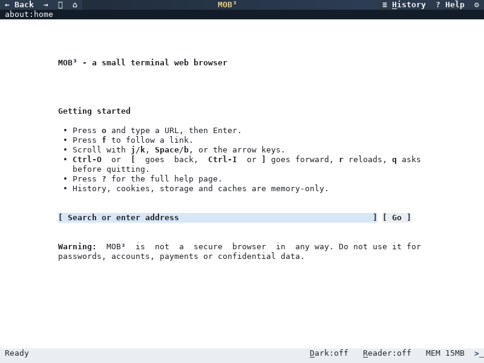
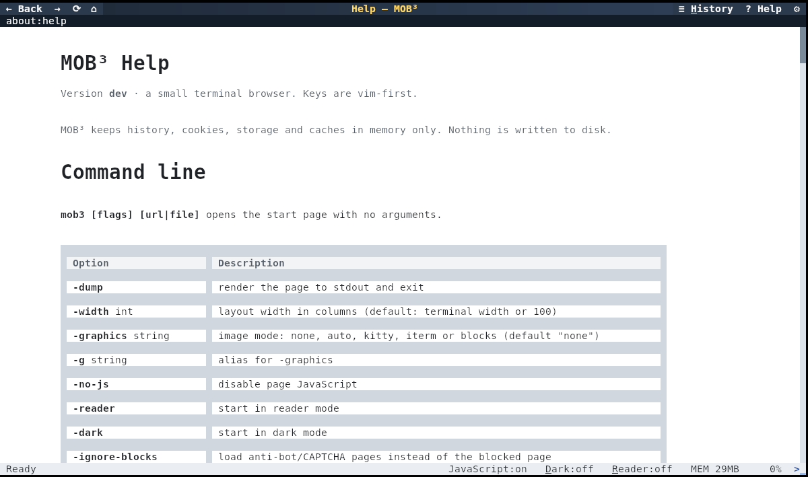
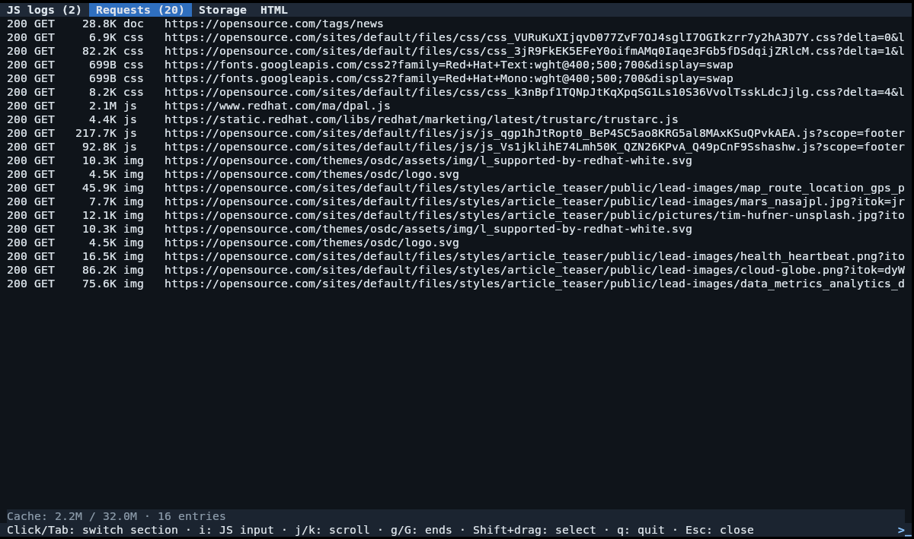
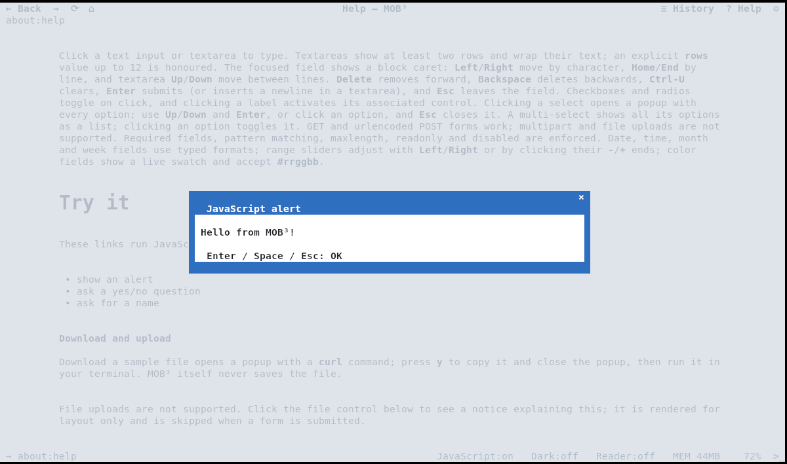
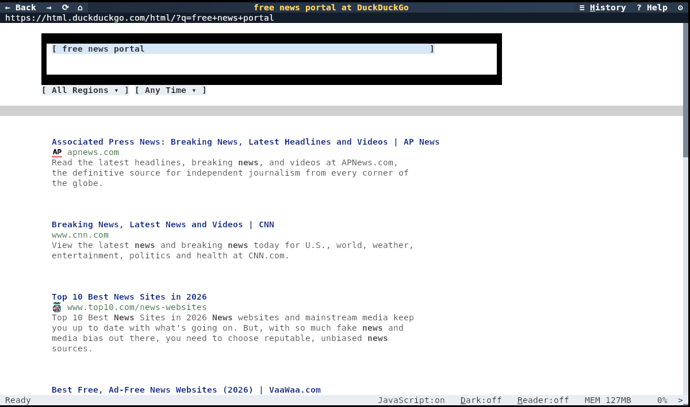
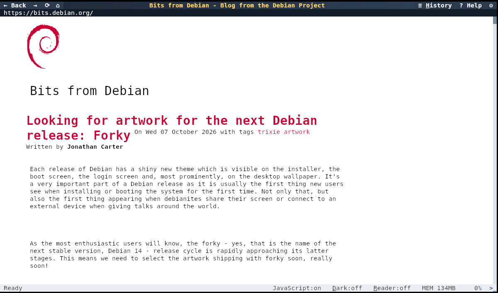
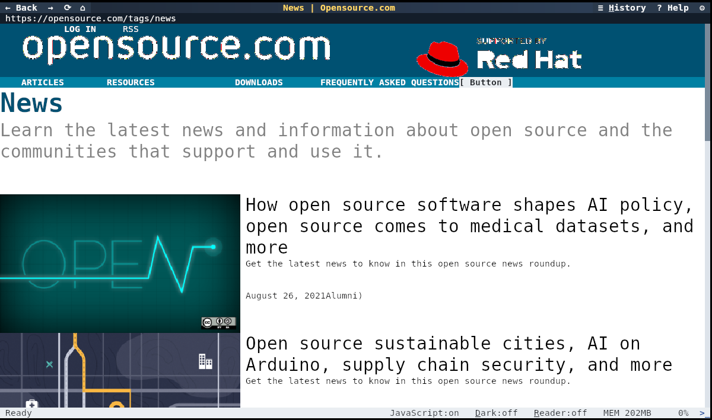
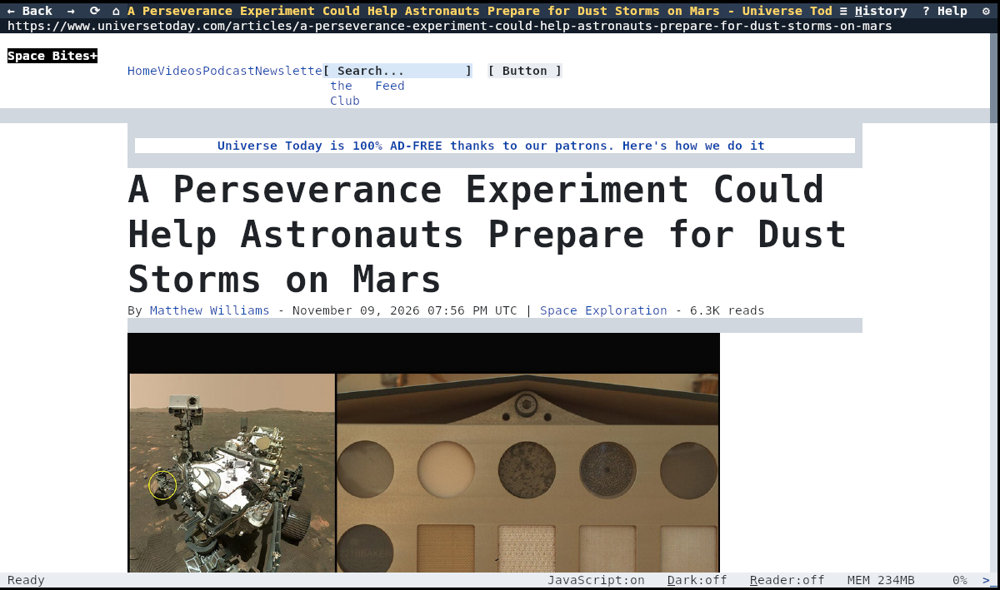
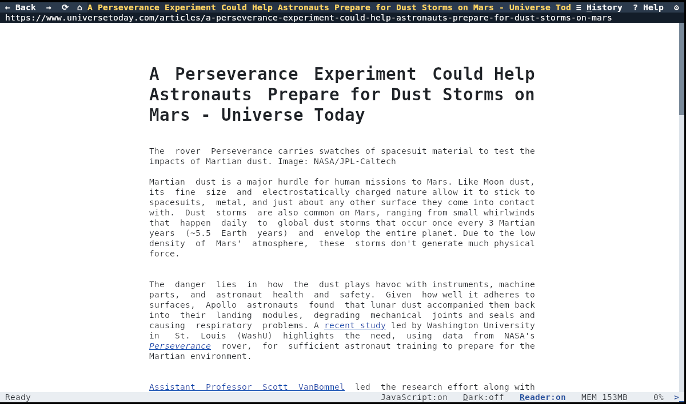
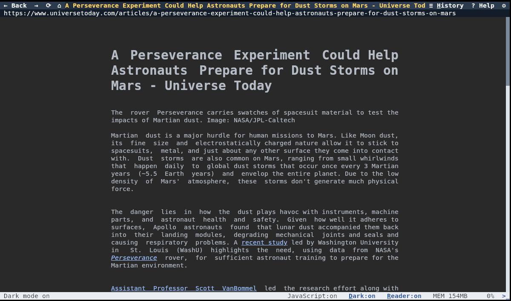

<p align="center">
  
</p>

# MOB³ is a small indie web browser for the terminal

MOB³ is a lightweight terminal web browser with a built-in HTML rendering engine, JavaScript runtime, ANSI renderer and inline image support. It brings Vim-style interaction, mouse controls and browser-like navigation together with headless MCP support for scripts and AI agents.

The design goal is most of the features people actually use, with a fraction of the CPU and memory a mainstream browser needs: a small static binary, fast startup and pages that stay lightweight.

Project page: [mob3.net](https://mob3.net)

GitHub: [github.com/mob3net/mob3](https://github.com/mob3net/mob3)

## Documentation

- [Documentation index](docs/index.md)
- [Use cases](docs/use-cases.md) — developers, AI agents, terminal users and automation
- [Install](docs/install.md) — releases, Docker and source builds
- [Command line](docs/cli.md) — every flag, default and limit
- [Keyboard and mouse](docs/keys.md)
- [Automation with MCP](docs/automation.md) — headless control for scripts and AI tools
- [Security and privacy](docs/security.md), [site support](docs/sites.md) and [development](docs/development.md)

## Try it with Docker:

```
docker run --rm -it ghcr.io/mob3net/mob3 -graphics blocks
```

## Download and install

[Download the latest MOB³ release](https://github.com/mob3net/mob3/releases/latest) from GitHub Releases.

Release archives cover Linux (`386`, `amd64`, `armv6`, `armv7`, `arm64`) and macOS (`amd64`, `arm64`). Choose the archive for your OS and architecture, for example `mob3_vX.Y.Z_linux_amd64.tar.gz`. Each archive contains the static `mob3` binary.

Example:

```
tar -xzf mob3_vX.Y.Z_linux_amd64.tar.gz
sudo install -m 0755 mob3 /usr/local/bin/mob3
mob3 -version
```

## Screenshots
<div align="center">
<a href="docs/screenshots/help.png" target="_blank" rel="noopener"></a>
<a href="docs/screenshots/console-storage.png" target="_blank" rel="noopener"></a>
<a href="docs/screenshots/help-dialogs.png" target="_blank" rel="noopener"></a>
<br />
<a href="docs/screenshots/hacker-news.png" target="_blank" rel="noopener"></a>
<a href="docs/screenshots/debian.png" target="_blank" rel="noopener"></a>
<a href="docs/screenshots/opensource.png" target="_blank" rel="noopener"></a>
<br />
<a href="docs/screenshots/universe-today-narrow.png" target="_blank" rel="noopener"></a>
<a href="docs/screenshots/universe-today.png" target="_blank" rel="noopener"></a>
<a href="docs/screenshots/reader-mode.png" target="_blank" rel="noopener"></a>
</div>

## Show your support
If MOB³ has been useful to you, please consider [giving the project a star on GitHub](https://github.com/mob3net/mob3). It helps others discover it and supports the continued development of the project.

## What to expect

MOB³ is a content browser, not a full browser engine. It is happiest with text-focused pages and gets rough on modern JavaScript-heavy apps.

**Works well**

- Documentation, blogs, news articles, wikis, forums, changelogs and old or server-rendered HTML.
- Headings, paragraphs, lists, links, tables, `<pre>` blocks, images and common presentational markup.
- Text/search inputs, textareas, single-select option popups and multi-select list boxes, with a visible caret, arrow-key editing, date/time/month/week, range sliders, color swatches, HTML constraint checks, GET and urlencoded POST form submission. The start page has justified text and a full-width search/URL box that resolves input the same way as the `o` prompt, including the `-search` fallback.
- Common CSS: selectors, cascade and inheritance, box model (including `box-sizing` and min/max sizes), margins, borders, background colors and `background-image` photos on block containers, text styling, lists, tables, CSS custom properties, viewport-width `@media` queries, viewport units, `calc()` and `min()`/`max()`/`clamp()`, basic flex rows with alignment and ordering, left/right floats with line wrapping and `clear`, and `overflow` clipping for bounded panels.
- PNG/JPEG/GIF/WebP/BMP/SVG/data-URI images when enabled with `-graphics` (`auto`, `kitty`, `iterm`, or `blocks` for half-block art); press `i` to cycle full graphics, blocks and none. Images are off by default for speed.
- Session-only memory cache for CSS, scripts and decoded images, budgeted at 3% of `-mem-limit` (or 32 MiB when unlimited).
- In-memory back/forward cache: Back and Forward restore the page, its DOM and its JavaScript state without a network reload and pause its timers while cached. The cache is memory-aware — a history budget of 12% of `-mem-limit` (or 128 MB when unlimited) evicts the least recently used pages by estimated size, and pages heavier than half the budget are not cached at all — so heavy sites cannot pin memory. Nothing is written to disk.
- Light JavaScript: DOM queries and mutation, `classList`/`style`, click handlers, timers, alert/confirm/prompt and native `<dialog>` open/close, same-origin `fetch`/`XMLHttpRequest` plus simple CORS cross-origin requests, and in-memory storage/cookies. Script errors turn the footer `JavaScript` label into a red `JavaScript:Error`; `J` or clicking that label toggles scripting for the session and reloads the page, while `!` opens the console.
- JavaScript console (`!`): tabbed view of logs, requests, cookies and in-memory storage, the raw page HTML, and a Tools tab for read-only page inspection (`help`, `form`, `links`, `requests`, `logs`, `source`, `snapshot`, `history`, `clear`); evaluate one-line expressions in the page's runtime, with Up/Down or Ctrl-P/Ctrl-N history and results appended to the log. `clear`/`cls` empties either the JS log or the Tools scrollback.
- Reader mode (`R`, the footer `Reader:on`/`Reader:off` label, or `-reader` at launch): extracts the main article into a narrow, chrome-free text column, stays enabled across navigation, and restores the normal page and scroll position when toggled off.
- Built-in text-only PDF viewer: a PDF response is extracted page by page into one continuous document with column alignment, a centered reading column and a `Page n` caption above an underscore rule after each page; every page is padded to the same height so it scrolls like a book, and two-column pages are read column by column. PDF headings keep their spacing, and runs clearly larger than the body text use the same 32px headline path (two rows, scaled glyphs in kitty) as HTML headings. Find, selection, `-dump` and `-png` work as on any page. The footer shows `Page n/N` with a clickable `(d -> Download name)` hint, and `d` opens the same curl popup. `-png` exports one page (`-pdf-page=N` or `all` for the whole document). Figures, images and annotations are not rendered; `-no-pdf` restores the download prompt.
- Dark mode (`D`, the footer `Dark:on`/`Dark:off` label, or `-dark` at launch): asks sites for their dark styles with `prefers-color-scheme: dark`. Pages that already render a dark background keep their own palette; otherwise backgrounds, text, links and borders are remapped to a dark palette. Images keep their original colors.
- Page zoom (`+` / `-`, `0` resets, or `-zoom N` at launch): changes how many CSS pixels a cell represents, so fixed-pixel layout, spacing, images and kitty scaled large headings grow or shrink while body text keeps its size and line height. The CSS viewport follows the ratio, so responsive pages reflow. Zoom is session-only; the URL row shows the current level, and clicking that badge opens a window for choosing a preset with the mouse.
- Vimium-style link hints (`f`): highlights letters from each visible link or form control, then follows the link or activates the control when you type them; `F` shows the destination highlighted in yellow first and waits for confirmation; `Esc` or scrolling dismisses the hints.
- Headless MCP automation (`-mcp`): navigate, snapshot page text and links, click links or elements by text, list and fill forms, select options, submit, wait for async content, type, press keys, scroll, evaluate JavaScript, inspect history and read request logs, JS errors or page source. Screen captures are terminal-cell rasters; sessions are memory-only.
- Browser-style toolbar with back/forward/reload/home, history/help buttons, a config gear and a centered page title.
- Keyboard and mouse navigation, including the kitty keyboard protocol in kitty, WezTerm, Ghostty and foot, a standard Tab order through links and form controls (Space/Enter activate, arrows or h/j/k/l change selects, radios and ranges), `/` incremental find (including multi-word phrases) with highlighted matches (also in the console HTML tab), a draggable page scrollbar, history (including a top-right History page listing the session's links, with `#` anchors as entries and back/forward restoring each page's last scroll position), scrolling, focus, link hover targets and CSS/JS hover menus, text selection (`y` copies selected text, or the current URL when nothing is selected), fixed-overlay hiding (`X`), and a `!` JavaScript console.

**Rough edges**

- Modern JavaScript apps (SPAs, dashboards, Google search and similar) may show a partial page, a blank page or their no-JavaScript fallback. ES module scripts run, including relative imports, dynamic `import()`, `import.meta.url` and bare specifiers resolved by the page's import map, and custom elements are constructed, but the rest of the JavaScript API surface is still a small subset.
- Reader mode is heuristic: it can pick too little or too much content on unusual layouts, shows a snapshot rather than live updates, and removes images, forms and other interactive controls. Dark mode keeps images in their original colors and approximates some author color schemes.
- Anti-bot and firewall checks (Cloudflare, CAPTCHA, DataDome/PerimeterX, Imperva/Sucuri, access-denied pages) are generally not usable. A “Site blocked” page is shown instead.
- No video/audio playback, WebGL, WebAssembly, workers, WebSockets, iframes, Shadow DOM, custom elements, real observers or full History API.
- Basic CSS grid rows and horizontal grid-item alignment are supported, along with `position:relative`, `position:absolute` and `position:fixed`, left/right floats with line wrapping and `clear`, and `overflow` clipping for bounded boxes. `position:sticky` with `bottom`/`left`/`right`, CSS variables, animations, transitions, non-text generated content, background gradients and repeating background tiles are unsupported or approximated.
- SVG support is partial: paths, shapes, gradients, transforms, `clipPath`, `fill-rule` and `<use>` of paths/groups work, but text inside SVG, `<use>` resolving to `<symbol>` sprites, filters, masks, CSS-in-SVG and animation are not rendered. Animated WebP is not supported.
- Oversized images are capped at 40% of the viewport width and 16 rows, preserving their aspect ratio. Images with a definite CSS box (both width and height) use `object-fit`/`object-position` and fill or crop into that box instead of hitting those caps.
- No tabs or automatic downloads; a download link opens a popup with a copyable `curl` command without fetching it, except a `.pdf` download, which opens in the text viewer (`-no-pdf` restores the popup for PDFs), and multipart/file uploads are not implemented (clicking a file input shows an unsupported notice). Selected page text copies with `y` through OSC 52 (terminal support required), and the URL can be selected with the terminal.
- Very large pages, stylesheets and images are capped to keep memory and CPU bounded. Style and layout also run under a time budget, so a pathological page is shown partially with a truncation notice instead of freezing the browser. Pages whose timers update the DOM are redrawn a few times per second rather than continuously, and an idle page with no pending timers does not repaint at all.

## Using command line options

Start reading Wikipedia in dark mode:
```
mob3 -dark -reader 'https://en.wikipedia.org/wiki/Vim_(text_editor)'
```
See all available options with -h flag. Every flag and default is listed in the [command-line reference](docs/cli.md).

Capture a PNG screenshot:

```sh
mob3 -png -width 120 bbc.com/news > bbc.png
```

## Automation (MCP)

`mob3 -mcp` runs a headless browser as a Model Context Protocol server over stdin/stdout. It accepts an optional starting URL and fixed `-width`:

```json
{
  "mcpServers": {
    "mob3": {
      "command": "/path/to/mob3",
      "args": ["-mcp", "-width", "100", "about:home"]
    }
  }
}
```

Tools: `navigate`, `snapshot`, `screenshot`, `click` (link number, CSS selector or `x`/`y`), `type`, `press`, `scroll`, `back`, `forward`, `reload`, `evaluate` and `history`. `snapshot` returns the current page viewport as text, visible links as `[n]` and form controls with coordinates. Results are text only: there is no pixel screenshot because MOB3 renders to terminal cells.

The server is local and unauthenticated, sessions and storage are memory-only, and nothing is written to disk. Do not expose it as a network service. See the [full MCP reference](docs/automation.md) for the protocol, snapshot format, tool details, and setup instructions for OpenCode, Claude Code, Cursor and Claude Desktop.

## Development

Build from source and start browsing:

```
make
./bin/mob3 https://example.com
```

Requires Go 1.27 or newer. Interactive mode runs on Linux and macOS terminals; Windows users can run it under WSL. When stdin/stdout are not a terminal, MOB³ automatically falls back to dump mode.

Press `?` inside the app for keys, mouse and forms help. Run `mob3 -h` for the full list of command-line flags. `mob3 -version` prints the embedded version.

## Contributing

Contributions are welcome. Every pull request must include the broad license-grant CLA statement described in [CONTRIBUTING.md](https://github.com/mob3net/mob3/blob/main/CONTRIBUTING.md); it keeps MOB³ available under both AGPL-3.0-only and a commercial license. The PR workflow checks the statement. The CI workflow runs formatting, vet and tests.

## License

MOB³ is licensed under the GNU Affero General Public License, version 3 only (AGPL-3.0-only). Copyright (c) 2026 Milos Stojanovic. See [LICENSE](https://github.com/mob3net/mob3/blob/main/LICENSE).

A separate commercial license is available on request for use without the AGPL's source-disclosure requirements.

MOB³ is provided “as is”, without warranty of any kind. See the warning at the top: this is not a security boundary.

Third-party module licenses are listed in [THIRD_PARTY_NOTICES](https://github.com/mob3net/mob3/blob/main/THIRD_PARTY_NOTICES).
